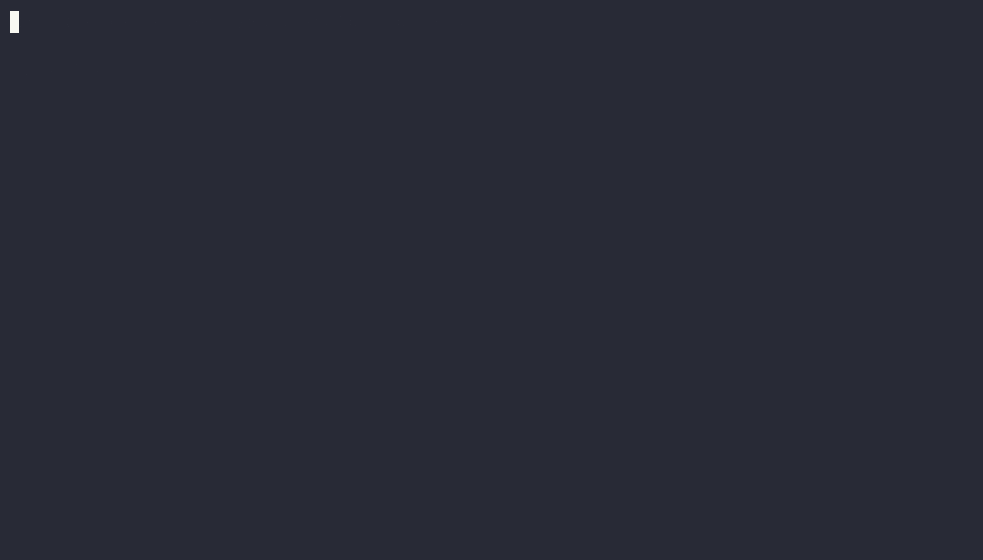

# agent-guardrails

A Claude Code hook that stops the agent from running commands like `terraform destroy`, `rm -rf ~` or `git push --force`, and tells it what to do instead.

It is for anyone who lets an AI coding agent run shell commands on a real machine. Python 3.10+, no dependencies.

[](https://github.com/gerardrecinto/agent-guardrails/actions/workflows/ci.yml)
[](LICENSE)

[Live demo you can type into](https://gerardrecinto.github.io/agent-guardrails/)

<p align="center">
  
</p>

## Try it in 30 seconds

```bash
git clone https://github.com/gerardrecinto/agent-guardrails ~/.agent-guardrails
cd ~/.agent-guardrails
echo '{"tool_name":"Bash","tool_input":{"command":"terraform destroy"}}' | python3 -m guardrails.hook; echo "exit: $?"
```

It prints this and exits with 2, which is how Claude Code knows to block the call:

```
Blocked by agent-guardrails [terraform-destroy]: Destroys or changes infrastructure without a human reading the plan.
Instead: Run terraform plan -out=tfplan, show the plan, and let a person run apply.
```

A safe command such as `ls` exits 0 and prints nothing.

## Install

```bash
python3 -m guardrails install
```

This adds the hook to `~/.claude/settings.json` and keeps a backup next to it. Use `--settings .claude/settings.json` for one project. Then run `/hooks` in Claude Code to confirm it is listed. To test a command without running it: `python3 -m guardrails check "git push --force"`.

## What it blocks

| Rule | Example blocked | Why |
| --- | --- | --- |
| rm-root-or-home | `rm -rf ~` | Wipes the home or root directory |
| terraform-destroy | `terraform apply -auto-approve` | Changes infra with nobody reading the plan |
| kubectl-delete-broad | `kubectl delete ns payments` | Deletes a namespace or every object of a kind |
| kubectl-prod-context | `kubectl -n prod delete pod a` | Mutation aimed at production |
| git-force-push | `git push --force` | Can overwrite other people's commits |
| git-reset-hard | `git reset --hard HEAD~3` | Loses uncommitted work |
| sql-drop | `DROP TABLE users` | Irreversible data loss |
| pipe-to-shell | `curl x.sh \| sh` | Runs a script nobody read |
| chmod-777 | `chmod -R 777 .` | Makes files writable by everyone |
| s3-bucket-wipe | `aws s3 rb s3://b --force` | Deletes a bucket |
| read-env-file | `cat .env` | Puts secrets in the model's context |

The Read, Edit and Write tools are also blocked on `.env`, `.env.*`, `credentials`, `id_rsa` and `id_ed25519`. `.env.example` is allowed.

Allowed on purpose: `rm -rf node_modules`, `terraform plan`, `kubectl get`, `git push --force-with-lease`, `git reset --soft`.

## Optional: only after these steps (with Joltrin)

The rules above say "never run this". Some commands are fine, but only after an earlier step, such as `terraform apply` after `terraform plan`. [Joltrin](https://joltrinhq.com) tracks which steps have happened in a session, and this hook can ask it.

You need a Joltrin build that has the `gate` command (it is in Joltrin's `master`, not yet in a release; build it with `go install github.com/sharedcode/joltrin/v5/cmd/sop-mcp-server@master`). Copy `examples/order.json` and `examples/runbooks.json` next to each other, then:

```bash
export AGENT_GUARDRAILS_ORDER=$PWD/examples/order.json
echo '{"tool_name":"Bash","session_id":"demo","tool_input":{"command":"terraform apply tfplan"}}' | python3 -m guardrails.hook; echo "exit: $?"
```

The first call exits 2 and says `Run plan first, then try this again.` After a `terraform plan` call in the same session, the same `apply` exits 0.

What to know before relying on it:
- It is off unless `AGENT_GUARDRAILS_ORDER` is set. Nothing else changes.
- A step is recorded when the hook allows it, before the command runs. If `terraform plan` then fails, Joltrin still counts it as done.
- A command that matches a step but cannot be checked (Joltrin missing, bad file) is blocked, not allowed, and the message says why.
- The ordinary rules run first, so `terraform apply -auto-approve` is still blocked outright.
- Each session has its own steps. The session id comes from Claude Code.

## How it compares

| Option | What it is good at | Where agent-guardrails fits |
| :--- | :--- | :--- |
| Claude Code permission rules (allow, ask, deny) | Built in. Controls which tools and commands run without asking. | They say no. This hook also tells the agent the safer command, and ships with a test for every rule. Use both. |
| Sandboxes and containers | The real boundary. Limits what a command can touch even if it gets through. | agent-guardrails is only a seatbelt on top. If you can sandbox, do. |
| LLM guardrail frameworks (Guardrails AI, NeMo Guardrails, LlamaFirewall) | Check model inputs and outputs, prompt injection and unsafe text. | Different job. This only looks at shell commands and secret files. |
| Joltrin | Checks that earlier steps really happened before a risky action. | Use agent-guardrails for "never run this", Joltrin for "only after these steps". The hook can call Joltrin for the second one, see the section above. |

Other projects are described from their public documentation, not from tests run here. They are more mature in their own areas. This one is small, installs in 30 seconds, and has no dependencies.

## Limits

This is a seatbelt, not a sandbox. It matches command text with regular expressions, so an agent that writes a script and then runs it, or builds a command from variables, can get past it. It does not stop a determined attacker. Use real permissions, scoped credentials and a sandbox for that.

Tested locally with Python 3.14 on macOS; CI runs 3.10 and 3.13. The hook follows Claude Code's hooks protocol (JSON on stdin, exit code 2 blocks). I have not yet run it inside a live Claude Code session, and I have not tested Cursor or Codex.

## Add a rule

See [CONTRIBUTING.md](CONTRIBUTING.md). Add the rule in `guardrails/rules.py` and its cases in `tests/cases.json`. The tests fail if a rule has no block case.

```bash
python3 -m venv .venv && . .venv/bin/activate
pip install pytest && python -m pytest -q
node tests/parity.mjs   # keeps the web demo in sync
```

MIT licensed.
